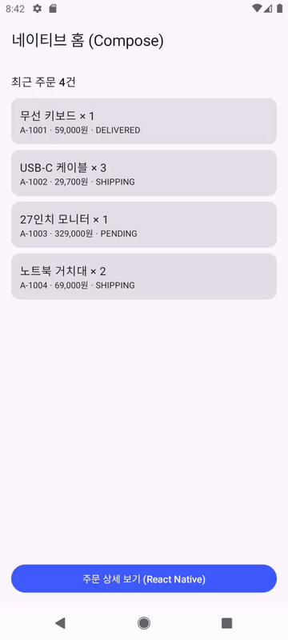
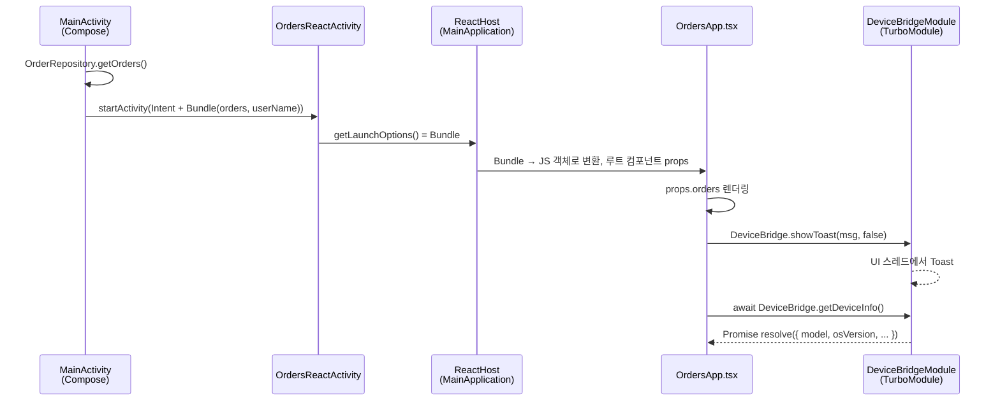

# RN Brownfield Demo

<p align="center">
  
</p>

Kotlin + Jetpack Compose로 만든 **기존(네이티브) 안드로이드 앱**에 React Native 화면을 **브라운필드 방식**으로 붙인 예제입니다.

- 네이티브 홈(Compose)에서 버튼 → RN 화면(TypeScript)으로 이동
- 네이티브 → RN 데이터 전달: 주문 목록을 `initialProps` 로 전달
- RN → 네이티브 호출: TurboModule(`NativeDeviceBridge`)로 토스트 / 기기 정보 조회

| 항목 | 버전 |
| --- | --- |
| React Native | 0.88.1 (New Architecture, Hermes) |
| React | 19.3.0 |
| AGP / Gradle / Kotlin | 9.2.1 / 9.4.1 / 2.2.0 |
| Compose BOM | 2026.02.01 |
| minSdk / targetSdk / compileSdk | 24 / 36 / 37 |

---

## 실행 방법

```bash
npm install
npm start                      # Metro 개발 서버 (터미널 1)
```

```bash
# 터미널 2: 에뮬레이터/기기 연결 후
adb reverse tcp:8081 tcp:8081  # 실기기일 때 필요 (에뮬레이터는 10.0.2.2로 자동 연결)
cd android && ./gradlew :app:installDebug
```

> 32비트 x86 에뮬레이터(예: API 30 `sdk_gphone_x86`)는 기본 ABI 설정(`x86_64,arm64-v8a`)에 포함되지 않아
> `INSTALL_FAILED_NO_MATCHING_ABIS` 가 납니다. 이때는 `./gradlew :app:installDebug -PreactNativeArchitectures=x86` 로 설치하세요.

Android Studio에서는 **`android/` 폴더를 프로젝트로 열고** 일반 앱처럼 Run 하면 됩니다. (Metro는 따로 `npm start`)

> 디버그 빌드는 JS를 Metro에서 받아오고, 릴리스 빌드(`assembleRelease`)는 JS 번들을 APK에 포함합니다.
> Metro 없이 디버그 APK를 돌리고 싶다면 `android/app/build.gradle.kts` 의 `react { debuggableVariants.set(listOf()) }` 로 디버그에도 번들을 포함시킬 수 있습니다.

---

## 프로젝트 구조

```
RNBrownfieldDemo/
├── package.json              # RN 의존성 + codegenConfig
├── index.js                  # AppRegistry.registerComponent("OrdersApp")
├── app.json                  # 컴포넌트 이름 "OrdersApp"
├── metro.config.js / babel.config.js / tsconfig.json
├── src/
│   ├── OrdersApp.tsx         # RN 화면 (주문 목록 + 네이티브 모듈 호출)
│   ├── types.ts              # 네이티브가 넘기는 props 타입
│   └── specs/
│       └── NativeDeviceBridge.ts   # TurboModule 스펙 (codegen 입력)
└── android/                  # ← 기존 네이티브 앱 (Android Studio로 여는 곳)
    ├── settings.gradle.kts   # RN gradle plugin include + autolinking
    ├── build.gradle.kts      # com.facebook.react.rootproject
    ├── gradle.properties     # newArchEnabled, hermesEnabled, ABI
    └── app/
        ├── build.gradle.kts  # com.facebook.react 플러그인, react-android, hermes-android
        └── src/main/java/com/example/rnbrownfield/
            ├── MainApplication.kt        # ReactApplication (ReactHost 보유)
            ├── MainActivity.kt           # Compose 홈 화면 진입점
            ├── data/                     # Order 모델, OrderRepository
            ├── ui/                       # Compose UI (HomeScreen, Theme)
            └── rn/
                ├── OrdersReactActivity.kt  # RN 화면 컨테이너 + initialProps 전달
                ├── OrderPropsMapper.kt     # Order → Bundle 변환
                ├── DeviceBridgeModule.kt   # TurboModule 구현 (codegen Spec 상속)
                └── AppNativePackage.kt     # 모듈 등록
```

**네이티브 코드와 RN 코드의 경계는 `rn/` 패키지 하나로 모았습니다.** 나머지 네이티브 코드(`data/`, `ui/`)는 RN의 존재를 모릅니다.

---

## 데이터 흐름



### 1) 네이티브 → RN : `initialProps`

```kotlin
// MainActivity.kt
startActivity(OrdersReactActivity.newIntent(this, orders, userName = "홍길동"))

// OrdersReactActivity.kt
override fun getLaunchOptions(): Bundle? = intent.getBundleExtra(EXTRA_INITIAL_PROPS)
```

`OrderPropsMapper` 가 `Order` 를 `Bundle` 로, 목록을 `ArrayList<Bundle>` 로 만듭니다.
RN은 `Arguments.fromBundle()` 로 이를 JS 객체 배열로 바꿔 `OrdersApp` 의 props로 넘깁니다.

```ts
// src/types.ts — 네이티브 Bundle 키와 1:1
export type OrdersAppProps = { userName?: string; orders?: Order[] };
```

### 2) RN → 네이티브 : TurboModule

```ts
// src/specs/NativeDeviceBridge.ts
export interface Spec extends TurboModule {
  showToast(message: string, isLong: boolean): void;
  getDeviceInfo(): Promise<DeviceInfo>;
}
```

빌드 시 codegen이 이 스펙으로 `com.example.rnbrownfield.specs.NativeDeviceBridgeSpec` (추상 클래스)를 생성하고,
`DeviceBridgeModule` 이 이를 상속해 구현합니다. 등록은 `MainApplication` 에서 `AppNativePackage` 를 추가해 이루어집니다.

---

## 이렇게 선택한 이유

### 디렉터리 구조: `android/` 하위에 네이티브 앱
RN 공식 "Integration with Existing Apps" 가이드가 권장하는 구조입니다. RN gradle plugin, autolinking, Metro가 모두
`root/node_modules`, `root/package.json` 을 기본 경로로 가정하기 때문에, 이 구조를 따르면 경로 설정을 거의 하지 않아도 됩니다.
반대 방식(네이티브 레포 안에 `rn/` 서브폴더)도 가능하지만 `react { root = ... }`, `includeBuild` 경로 등을 모두 직접 맞춰야 합니다.

### RN 화면 컨테이너: `ReactActivity` (Fragment / Compose 안의 `ReactRootView` 대신)
- 홈 → 상세라는 "화면 단위 전환"에는 Activity가 가장 단순하고, 뒤로가기·생명주기·Dev Menu 처리를 `ReactActivity` 가 대신해 줍니다.
- 네이티브 쪽에서는 그냥 `startActivity(Intent)` 이므로 기존 네비게이션 방식과 똑같이 다룰 수 있습니다.
- 한 화면 일부만 RN으로 그려야 한다면 `ReactFragment` 나 `AndroidView { reactHost.createSurface(...) }` 로 확장할 수 있습니다.

### 데이터 전달: `initialProps` (Bundle)
- 화면 진입 시점에 필요한 "읽기용 데이터"에는 가장 직관적입니다. RN 쪽에서 별도 호출 없이 첫 렌더부터 데이터가 있습니다.
- JSON 문자열로 넘기는 방법보다 직렬화/파싱 코드가 없고, `types.ts` 로 타입을 명시할 수 있습니다.
- 한계: Intent 크기 제한(~1MB)이 있고 **진입 시 1회성**입니다. 데이터가 크거나 화면을 연 뒤 갱신이 필요하면
  TurboModule 메서드(`getOrders(): Promise<Order[]>`)나 네이티브 → JS 이벤트(`EventEmitter`)로 바꾸는 것이 맞습니다.

### 네이티브 모듈: Codegen 기반 TurboModule (레거시 `ReactContextBaseJavaModule` 대신)
- RN 0.82부터 New Architecture가 기본이자 필수이고, 레거시 모듈은 interop 레이어로만 동작합니다.
- TS 스펙 하나가 **JS와 Kotlin 양쪽의 계약**이 됩니다. 시그니처가 틀리면 Kotlin 컴파일 에러가 나므로 런타임 오류가 줄어듭니다.
- 모듈은 JS에서 처음 접근할 때 lazy 하게 생성되어 시작 비용이 없습니다.

### `ReactHost` 를 `by lazy` 로
기존 네이티브 사용자는 RN 화면에 들어가지 않을 수도 있습니다. `loadReactNative()` 는 네이티브 라이브러리만 준비하고,
JS 런타임(Hermes) 생성은 첫 RN 화면 진입 때로 미룹니다. 첫 진입 지연이 문제가 되면 홈 화면 표시 후 `reactHost.start()` 로 미리 데워둘 수 있습니다.

### Gradle 설정
- 네이티브 앱은 Kotlin DSL(`.kts`)을 유지하고, RN 0.88 템플릿과 **같은 AGP/Kotlin 버전**(9.2.1 / 2.2.0)을 사용해 버전 충돌을 피했습니다.
- `android.builtInKotlin=false`, `android.newDsl=false` : AGP 9의 신규 기능을 RN gradle plugin이 아직 지원하지 않아 RN 템플릿과 동일하게 opt-out 했습니다.
- `reactNativeArchitectures=x86_64,arm64-v8a` : 개발 빌드 시간을 줄이기 위함입니다. 배포 시에는 필요한 ABI를 추가하세요.
- 앱 레벨 TurboModule은 C++ (JNI) 바인딩이 함께 생성되므로 NDK(`27.1.12297006`)가 필요합니다. 처음 빌드 시 자동 설치됩니다.

---

## 트러블슈팅

이 프로젝트를 만들면서 실제로 겪은 문제들입니다.

| 증상 | 원인 | 해결 |
| --- | --- | --- |
| 설치 시 `INSTALL_FAILED_NO_MATCHING_ABIS` | 32비트 x86 에뮬레이터인데 기본 ABI가 `x86_64,arm64-v8a` | `./gradlew :app:installDebug -PreactNativeArchitectures=x86` |
| Gradle이 `local.properties` 에서 `Malformed \uxxxx encoding` 오류 | Windows 경로의 `\U...` 가 유니코드 이스케이프로 해석됨 | `sdk.dir=C\:/Users/<you>/AppData/Local/Android/Sdk` 처럼 `/` 사용 |
| `npm run typecheck` 에서 `Cannot find type definition file for 'jest'` | `@react-native/typescript-config` 가 jest 타입을 기본 포함 | `tsconfig.json` 에 `"types": ["react-native"]` 지정 |
| RN 화면 하단 버튼이 시스템 내비게이션 바에 가려짐 | `edgeToEdgeEnabled=true` 라 콘텐츠가 시스템 바 아래까지 그려짐 | 하단 여백 추가 (실서비스는 `react-native-safe-area-context` insets 권장) |
| RN 화면이 빨간 화면 / `Unable to load script` | Metro 미실행 또는 기기에서 8081 포트 접근 불가 | `npm start` 실행 확인 후 `adb reverse tcp:8081 tcp:8081` |
| 첫 빌드가 매우 오래 걸림 | 앱 레벨 TurboModule의 JNI 코드 빌드용 NDK 자동 설치 + C++ 컴파일 | 정상 동작. 이후 빌드는 캐시로 빨라짐 |
| Git Bash에서 `adb shell screenrecord /sdcard/...` 경로가 깨짐 | MSYS가 `/sdcard` 를 Windows 경로로 변환 | 명령 앞에 `MSYS_NO_PATHCONV=1` (이때 `adb pull` 의 로컬 경로는 Windows 형식으로) |

---

## 다음 단계로 해볼 만한 것

- RN → 네이티브 결과 전달 (예: 주문 선택 시 `finish()` + `setResult`) 및 네이티브 → JS 이벤트
- 홈 화면 진입 후 `ReactHost` 프리워밍으로 첫 RN 화면 진입 속도 개선
- Compose 화면 안에 RN Surface를 부분적으로 임베드
- JS 번들을 별도 AAR로 분리해 네이티브 팀이 Node 없이 빌드할 수 있게 하기
